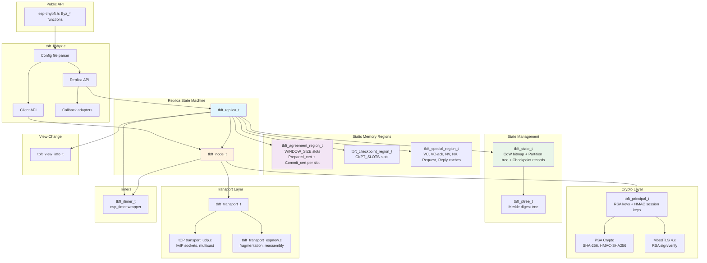
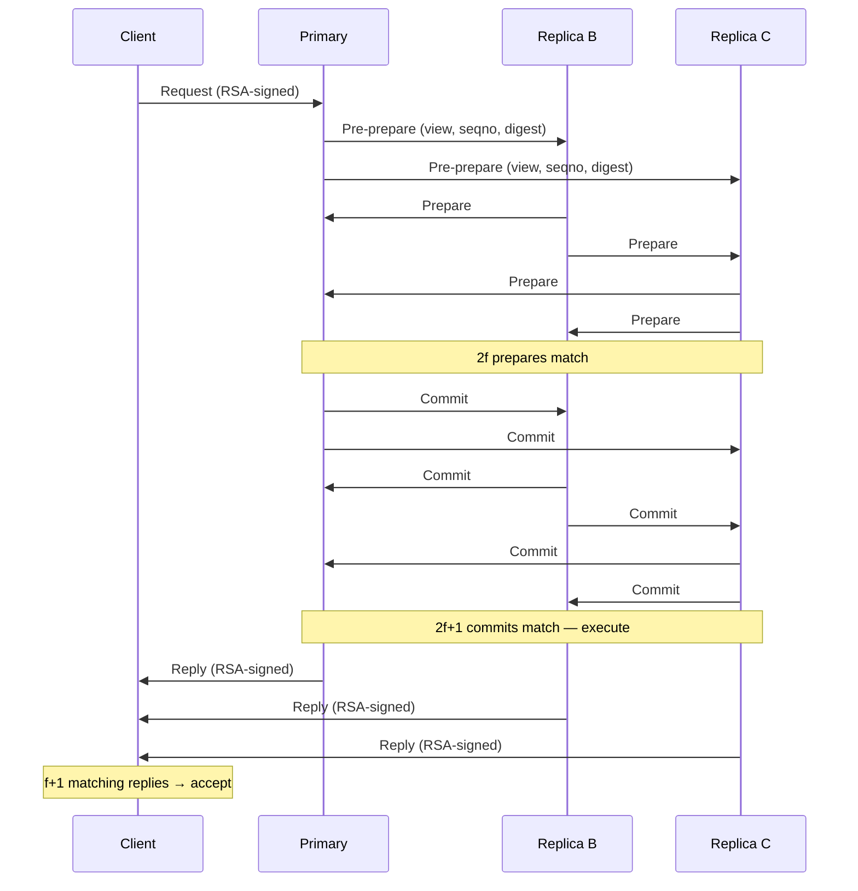
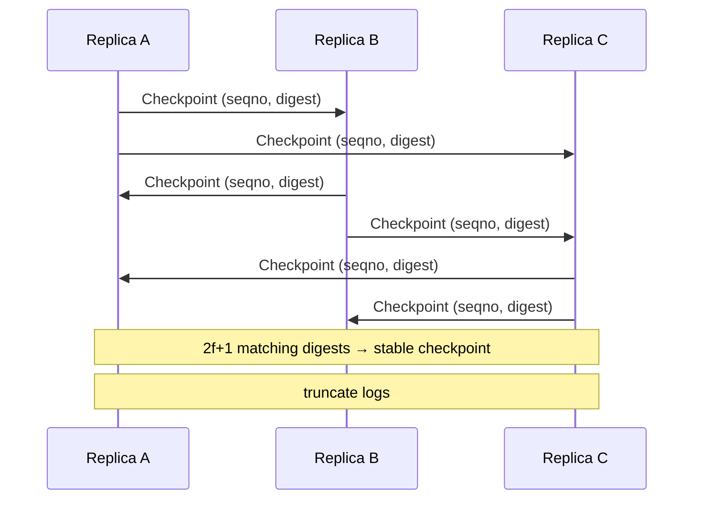
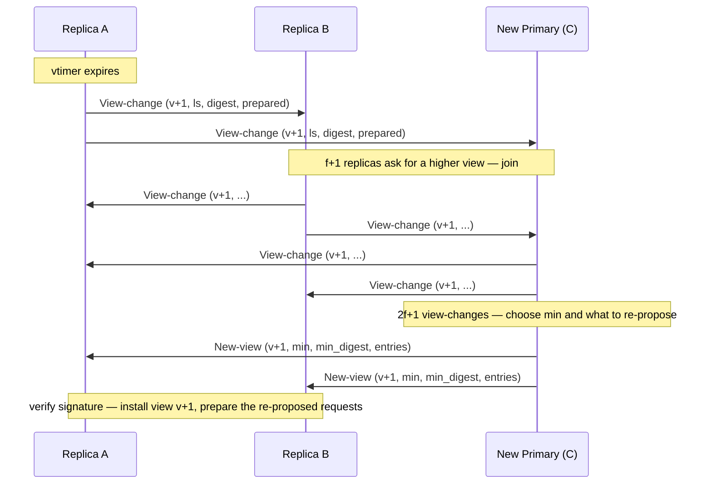

# esp-tinybft Architecture

TinyBFT is a pure-C implementation of PBFT (Practical Byzantine Fault Tolerance) optimised for embedded systems running ESP-IDF. It uses static memory allocation throughout -- no `malloc` in the hot path -- and supports two transport backends: UDP over lwIP sockets and ESP-NOW with automatic fragmentation/reassembly. Cryptography uses PSA Crypto for SHA-256/HMAC (fast path) and MbedTLS 4.x for RSA-2048 signatures (slow path).

## 1. Overview

### BFT Model

TinyBFT implements the PBFT protocol for a cluster of `n = 3f + 1` replicas, tolerating up to `f` Byzantine (arbitrarily faulty) nodes. The default configuration is `f = 1`, giving `n = 4` replicas.

### Protocol Phases

| Phase | Messages | Quorum | Purpose |
|---|---|---|---|
| Normal-case ordering | Request, Pre-prepare, Prepare, Commit, Reply | 2f prepares, 2f+1 commits | Totally order client requests |
| Checkpoint | Checkpoint | 2f+1 matching | Garbage-collect logs, prove execution |
| View-change | View-change, New-view | 2f+1 view-changes | Replace faulty primary |
| State transfer | Fetch, Meta-data, Data | 1 replier | Bring lagging replica up to date |

### Fault Tolerance Matrix

| Config value | f (faulty) | n (replicas) | Quorum (2f+1) |
|---|---|---|---|
| `TBFT_MAX_NUM_REPLICAS = 4` | 1 | 4 | 3 |
| `TBFT_MAX_NUM_REPLICAS = 7` | 2 | 7 | 5 |
| `TBFT_MAX_NUM_REPLICAS = 10` | 3 | 10 | 7 |

## 2. Architecture Diagram



## 3. Transport Layer

### Backend Selection

Controlled by Kconfig `TBFT_TRANSPORT_TYPE`:

| Choice | Macro | Source File |
|---|---|---|
| UDP over lwIP | `CONFIG_TBFT_TRANSPORT_UDP` | `src/tbft_transport_udp.c` |
| ESP-NOW | `CONFIG_TBFT_TRANSPORT_ESPNOW` | `src/tbft_transport_espnow.c` |

### Public API (src/tbft_transport.h)

```c
typedef enum {
    TBFT_TRANSPORT_UDP = 0,
    TBFT_TRANSPORT_ESPNOW = 1,
} tbft_transport_type_t;

int tbft_transport_create(tbft_transport_t **out, tbft_transport_type_t type,
                          int num_nodes, const char *mcast_ip, uint16_t port);
void tbft_transport_free(tbft_transport_t *t);
void tbft_transport_set_peer(tbft_transport_t *t, tbft_node_id_t node_id,
                             const tbft_addr_t *addr);
int tbft_transport_send(tbft_transport_t *t, const void *buf, size_t len,
                        tbft_node_id_t dest);
int tbft_transport_recv(tbft_transport_t *t, void *buf, size_t buf_len,
                        tbft_node_id_t *src_id);
```

### UDP Backend (`tbft_udp_t` internal struct)

```c
typedef struct {
    int sock;
    struct sockaddr_in mcast_addr;
    bool use_multicast;
    tbft_addr_t  peers[TBFT_MAX_NUM_REPLICAS + TBFT_MAX_NUM_CLIENTS];
    bool         peer_valid[TBFT_MAX_NUM_REPLICAS + TBFT_MAX_NUM_CLIENTS];
    int          num_nodes;
} tbft_udp_t;
```

- Opens a non-blocking UDP socket with `SO_REUSEADDR`
- If `mcast_ip` is provided and `TBFT_DISABLE_MULTICAST` is not set, joins the multicast group via `IP_ADD_MEMBERSHIP`
- Broadcast (`dest == TBFT_ALL_REPLICAS`) sends via multicast or iterates unicast to each peer
- `recvfrom` is non-blocking; returns 0 when no data available
- Sender identification by matching `IP:port` against peer table

### ESP-NOW Backend (`tbft_espnow_t` internal struct)

```c
typedef struct {
    uint16_t msg_id;
    uint8_t  frag_idx;
    uint8_t  frag_total;
} frag_hdr_t;  // 4 bytes, packed

typedef struct {
    uint8_t   buf[TBFT_MAX_MESSAGE_SIZE];
    int       buf_len;
    uint16_t  msg_id;
    uint8_t   frag_total;
    uint8_t   frag_received;
    uint32_t  frag_mask;       // bitmask, supports up to 32 fragments
    uint8_t   src_mac[6];
    bool      valid;
    bool      stale;           // marked for deferred clear by task
    TickType_t last_tick;
    uint16_t  last_frag_len;   // payload size of fragment (frag_total-1)
} reasm_slot_t;

typedef struct tbft_espnow {
    tbft_addr_t  peers[TBFT_MAX_NUM_REPLICAS + TBFT_MAX_NUM_CLIENTS];
    bool         peer_valid[TBFT_MAX_NUM_REPLICAS + TBFT_MAX_NUM_CLIENTS];
    int          num_nodes;

    /* Queue of fully reassembled messages ready for delivery */
    QueueHandle_t msg_queue;

    /* Send queue: entries posted by replica task, consumed by send_task */
    QueueHandle_t send_queue;
    TaskHandle_t  send_task_handle;
    TaskHandle_t  replica_task_handle;  // for waking from recv callback

    /* Reassembly slots */
    reasm_slot_t  reasm[REASM_MAX_SLOTS];

    /* Monotonic message ID counter (protected by lock) */
    uint16_t next_msg_id;

    /* Mutex — provides priority inheritance, preventing priority inversion
     * between the lower-priority send_task (3) and higher-priority callers (5+) */
    SemaphoreHandle_t lock;

    /* Flag to signal task context has stale slots to clear */
    volatile bool reasm_stale_flag;

    /* Set during teardown to reject new send/recv calls */
    volatile bool shutting_down;
} tbft_espnow_t;
```

Key properties:
- ESP-NOW v2.0 max data length: 1470 bytes (`ESP_NOW_MAX_DATA_LEN_V2`)
- Fragment header: 4 bytes (`msg_id`, `frag_idx`, `frag_total`)
- Max payload per fragment: 1466 bytes
- Max fragments for a `TBFT_MAX_MESSAGE_SIZE` (1440) message: 2
- Reassembly uses a FreeRTOS `QueueHandle_t` (`msg_queue`, depth 8) with entries of size `6 + 4 + TBFT_MAX_MESSAGE_SIZE`
- Reassembly timeout: 5000 ms
- Send is event-driven: the replica task posts a `send_entry_t` to `send_queue` (non-blocking, depth 8) and returns immediately; a dedicated low-priority `send_task` (priority 3) drains the queue and handles all ESP-NOW I/O with `vTaskDelay` yields between fragments
- `espnow_recv_cb` runs in the **WiFi task context** (not an ISR) — standard FreeRTOS task-context APIs (`xSemaphoreTake`, `xQueueSend`) are used throughout
- Peers registered via `esp_now_add_peer` with `WIFI_IF_STA`

### Network Address Type

```c
typedef struct { uint8_t bytes[6]; } tbft_mac_addr_t;

typedef struct {
    union {
        struct { uint32_t ip; uint16_t port; } udp;  // network byte order
        tbft_mac_addr_t mac;
    } u;
} tbft_addr_t;
```

## 4. Crypto Layer

### PSA Migration

All hashing and HMAC operations use **PSA Crypto**, not MbedTLS direct APIs, because MbedTLS 4.x made functions like `mbedtls_sha256()` and HMAC private.

| Operation | PSA API | Purpose |
|---|---|---|
| SHA-256 digest | `psa_hash_compute(PSA_ALG_SHA_256, ...)` | Message digests, state block digests |
| HMAC-SHA256 | `psa_mac_compute(key_id, PSA_ALG_HMAC(PSA_ALG_SHA_256), ...)` | Authenticator slots (hot path) |
| RSA encrypt | `psa_asymmetric_encrypt(key_id, PSA_ALG_RSA_PKCS1V15_CRYPT, ...)` | Session key exchange |
| RSA decrypt | `psa_asymmetric_decrypt(key_id, PSA_ALG_RSA_PKCS1V15_CRYPT, ...)` | Session key reception |

### RSA via MbedTLS 4.x

RSA signing and verifying use MbedTLS `pk_sign` / `pk_verify` with `MBEDTLS_MD_SHA256`. MbedTLS 4.x removed `f_rng`/`p_rng` parameters from these functions.

For RSA encryption/decryption (session key exchange), the MbedTLS `mbedtls_pk_context` is imported into a transient PSA key via `mbedtls_pk_import_into_psa`, then `psa_asymmetric_encrypt` / `psa_asymmetric_decrypt` are used with PKCS#1 v1.5 padding.

### Key Types

```c
typedef struct { uint8_t bytes[32]; } tbft_digest_t;  /* SHA-256 */
typedef struct { uint8_t bytes[32]; } tbft_mac_t;      /* HMAC-SHA256 */
typedef struct { uint8_t bytes[32]; } tbft_hmac_key_t; /* Session key */
typedef struct { uint8_t bytes[256]; } tbft_sig_t;     /* RSA-2048 signature */
```

### Authenticator (tbft_auth_t)

```c
typedef struct {
    tbft_mac_t slots[TBFT_MAX_NUM_REPLICAS - 1];
} tbft_auth_t;
```

Each slot holds an HMAC-SHA256 computed with the symmetric key shared with one remote replica. Slot `i` corresponds to replica index `i` with the local node's own slot skipped. Total size: `32 * (TBFT_MAX_NUM_REPLICAS - 1)` bytes. For `f=1` (4 replicas): 96 bytes.

### Digest Comparison

`tbft_digest_equal()` uses constant-time comparison (XOR accumulation) to avoid timing side-channels.

## 5. Node (tbft_node_t)

### Struct Layout (src/tbft_node.h)

```c
struct tbft_node {
    tbft_node_id_t  node_id;
    int             max_faulty;     /* f */
    int             num_replicas;   /* n = 3f+1 */
    int             threshold;      /* 2f+1 */
    tbft_view_t     view;
    int             cur_primary;    /* view % num_replicas */

    tbft_principal_t  *principals[TBFT_MAX_NUM_REPLICAS + TBFT_MAX_NUM_CLIENTS];
    int                num_principals;
    tbft_principal_t  *local_principal;   /* shortcut */

    tbft_transport_t   *transport;
    uint8_t   recv_buf[TBFT_MAX_MESSAGE_SIZE];

    tbft_itimer_t  atimer;
    int64_t        auth_timeout_us;
    uint64_t       rid_counter;
};
```

### All Functions

| Function | Signature | Description |
|---|---|---|
| `tbft_node_init` | `(node, node_id, f, num_nodes, mcast_ip, auth_timeout_us, port) -> int` | Initialise node, create transport, init auth timer |
| `tbft_node_free` | `(node) -> void` | Free timer, transport, all principals |
| `tbft_node_send` | `(node, buf, len, dest) -> int` | Delegate to transport |
| `tbft_node_recv` | `(node, buf, src_id) -> int` | Delegate to transport; returns 0 if truncated |
| `tbft_node_gen_auth` | `(node, msg, msg_len, auth) -> void` | Fill HMAC for each remote replica into `auth->slots[]` |
| `tbft_node_verify_auth` | `(node, sender_id, msg, msg_len, mac) -> bool` | Verify one HMAC slot from `sender_id` |
| `tbft_node_gen_sig` | `(node, msg, msg_len, sig) -> int` | RSA-sign via local principal |
| `tbft_node_verify_sig` | `(node, sender_id, msg, msg_len, sig) -> bool` | RSA-verify via sender's principal |
| `tbft_node_new_rid` | `(node) -> tbft_req_id_t` | Monotonic counter: `(node_id << 48) | counter`; `Byz_init_client` starts the counter at `boot_epoch << 24` (epoch from NVS) so ids keep growing across reboots |
| `tbft_node_primary` | `(node, v) -> int` | Inline: `v % num_replicas` |
| `tbft_node_is_replica` | `(node, id) -> bool` | Inline: `0 <= id < num_replicas` |

### Invariants

- `num_replicas` is always `3 * max_faulty + 1`
- `threshold` is always `2 * max_faulty + 1`
- `cur_primary` is always `view % num_replicas`
- `principals[]` array holds all known participants (replicas first by index, then clients)

## 6. Principal (tbft_principal_t)

### Struct Layout (src/tbft_principal.h)

```c
typedef struct {
    tbft_node_id_t  id;
    tbft_addr_t     addr;
    mbedtls_pk_context  pub_pk;        /* RSA public key */
    mbedtls_pk_context  priv_pk;       /* RSA private key (local only) */
    bool                has_priv_key;
    tbft_hmac_key_t hmac_in_key;       /* verify MACs from this principal */
    tbft_hmac_key_t hmac_out_key;      /* generate MACs for this principal */
    bool            keys_fresh;        /* true if keys have been exchanged */
    psa_key_id_t    psa_hmac_in_id;    /* persistent PSA key for verify; 0 = not loaded */
    psa_key_id_t    psa_hmac_out_id;   /* persistent PSA key for sign; 0 = not loaded */
    int64_t         last_auth_time_us; /* anti-replay timestamp */
} tbft_principal_t;
```

### All Functions

| Function | Signature | Description |
|---|---|---|
| `tbft_principal_init` | `(p, id, addr) -> void` | Zero-fill, init MbedTLS contexts, call `psa_crypto_init()` |
| `tbft_principal_ensure_psa` | `() -> void` | Idempotent PSA crypto initialisation (called before any principal exists) |
| `tbft_principal_load_pub_key` | `(p, der, der_len) -> int` | Parse DER-encoded public key via `mbedtls_pk_parse_public_key` |
| `tbft_principal_load_priv_key` | `(p, der, der_len) -> int` | Parse DER-encoded private key via `mbedtls_pk_parse_key` |
| `tbft_principal_free` | `(p) -> void` | Free MbedTLS/PSA contexts, zero-fill |
| `tbft_principal_gen_mac_out` | `(p, msg, msg_len, mac) -> int` | HMAC-SHA256 with persistent PSA `psa_hmac_out_id` |
| `tbft_principal_verify_mac_in` | `(p, msg, msg_len, mac) -> bool` | HMAC-SHA256 with persistent PSA `psa_hmac_in_id`, constant-time compare |
| `tbft_principal_verify_mac_in_with_replay_check` | `(p, msg, msg_len, mac, msg_time) -> bool` | As above + anti-replay timestamp validation |
| `tbft_principal_update_auth_time` | `(p, time_us) -> void` | Inline helper to set `last_auth_time_us` |
| `tbft_principal_set_in_key` | `(p, key) -> void` | Set `hmac_in_key`, import to PSA, run self-test, set `keys_fresh = true` |
| `tbft_principal_set_out_key` | `(p, key) -> void` | Set `hmac_out_key`, import to PSA `psa_hmac_out_id` |
| `tbft_principal_sign` | `(p, msg, msg_len, sig) -> int` | SHA-256 via PSA + `mbedtls_pk_sign` |
| `tbft_principal_verify_sig` | `(p, msg, msg_len, sig) -> bool` | SHA-256 via PSA + `mbedtls_pk_verify` |
| `tbft_principal_encrypt_new_key` | `(p, new_out_key, enc_buf, enc_buf_len, out_enc_len) -> int` | Import pub key to PSA, `psa_asymmetric_encrypt` with PKCS#1 v1.5 |
| `tbft_principal_decrypt_new_key` | `(p, enc_buf, enc_len, new_in_key) -> int` | Import priv key to PSA, `psa_asymmetric_decrypt` with PKCS#1 v1.5 |

### PSA Initialisation

PSA Crypto is initialised once via `psa_crypto_init()` on the first call to `tbft_principal_init()`. A static `bool s_psa_init` flag guards against duplicate initialisation.

### HMAC Implementation

HMAC operations use **persistent PSA key handles** (`psa_hmac_in_id`, `psa_hmac_out_id`) imported once when session keys are set via `tbft_principal_set_in_key` / `tbft_principal_set_out_key`. This avoids the import/destroy overhead on every MAC operation. The in-key also runs a self-test (compute + verify round-trip) to validate the key was imported correctly.

The anti-replay check (`tbft_principal_verify_mac_in_with_replay_check`) was **disabled** in the hot path due to ESP32 boot-time clock skew making `esp_timer_get_time()` unreliable across nodes. Replay protection is provided instead by the HMAC key itself — old messages fail verification under a newly rotated key.

### Session Key Exchange & Fast-Path Optimization

Bootstrapping session keys in a Byzantine environment involves expensive asymmetric cryptographic operations:
- A `New_key` message contains $N-1$ RSA-encrypted session key slots (one for each peer) and an RSA signature over the message.
- Parsing a single `New_key` message requires:
  1. RSA signature verification to authenticate the sender (~800ms).
  2. RSA private-key decryption to extract the local node's shared HMAC key (~800ms).

Because `New_key` messages are re-broadcasted periodically during bootstrapping to ensure all nodes receive them (guarding against packet drops), processing duplicate messages would consume 100% of CPU time and starve the event loop, causing consensus timeouts.

To prevent this CPU starvation, a zero-overhead, cryptographically secure **Fast-Path Verification Bypass** is implemented:
1. **Receiver-Side Ciphertext Cache**: Each `tbft_principal_t` stores the last successfully decrypted ciphertext block in `last_new_key_ciphertext`.
2. **Fast-Path Check**: When a `New_key` message is received:
   - The replica checks if the RSA-encrypted ciphertext slot for the local node exactly matches `last_new_key_ciphertext` and the shared HMAC session key is already fresh.
   - If they match, the replica **bypasses both the RSA signature verification and the RSA private-key decryption**, instantly accepting the message with zero overhead.
3. **Sender-Side Ciphertext Cache**: When a replica re-broadcasts its `New_key` message without rotating the session keys, it bypasses the slow RSA encryption function and copies the previously generated/cached ciphertext block byte-for-byte, avoiding sender-side RSA overhead.

## 7. Replica State Machine (tbft_replica_t)

### Struct Layout (src/tbft_replica.h)

```c
typedef struct {
    uint8_t  buf[TBFT_MAX_MESSAGE_SIZE];
    int      len;
    bool     ro;    /* read-only */
    bool     used;
} tbft_rqueue_entry_t;

typedef struct {
    tbft_rqueue_entry_t entries[TBFT_RQUEUE_MAX];
    int head, tail, count;
} tbft_rqueue_t;

/* Client table entry: the last request executed for one client and its
 * reply.  The table is part of the replicated state. */
typedef struct {
    tbft_req_id_t last_rid;
    tbft_seqno_t  seqno;
    int32_t       reply_len;   /* -1: the application rejected the request */
    int32_t       _pad;
    uint8_t       reply[TBFT_MAX_REPLY_SIZE];
} tbft_client_entry_t;

typedef struct {
    tbft_node_t  node;   /* MUST be first -- enables pointer aliasing */

    /* Sequence numbers */
    tbft_seqno_t  seqno;                   /* next to assign (primary) */
    tbft_seqno_t  last_stable;
    tbft_seqno_t  last_prepared;
    tbft_seqno_t  last_executed;

    /* Per-principal request ids: received, executed, forwarded (backup),
     * given a sequence number (primary) */
    tbft_req_id_t last_received_rid[TBFT_MAX_NUM_REPLICAS + TBFT_MAX_NUM_CLIENTS];
    tbft_req_id_t last_executed_rid[...];
    tbft_req_id_t last_forwarded_rid[...];
    tbft_req_id_t last_assigned_rid[...];

    /* Library part of the replicated state: the client table */
    alignas(8) uint8_t sys_state[TBFT_SYS_STATE_SIZE];

    /* View change: highest view each replica asked for; timer back-off */
    tbft_view_t   vc_view_seen[TBFT_MAX_NUM_REPLICAS];
    int           vc_backoff_shift;

    /* Latest Status of each replica and what we had at that time
     * (drives retransmission) */
    tbft_view_t   peer_view[TBFT_MAX_NUM_REPLICAS];
    bool          peer_in_vc[TBFT_MAX_NUM_REPLICAS];
    int64_t       peer_status_us[TBFT_MAX_NUM_REPLICAS];
    tbft_seqno_t  peer_seen_top[TBFT_MAX_NUM_REPLICAS];
    tbft_seqno_t  peer_seen_stable[TBFT_MAX_NUM_REPLICAS];
    int64_t       retx_us[TBFT_MAX_NUM_REPLICAS];
    int64_t       last_ask_us;
    tbft_seqno_t  stable_wait_seqno;
    int64_t       stable_wait_us;
    int64_t       last_nk_reply_us;
    int64_t       reply_sent_us[TBFT_MAX_NUM_CLIENTS];

    /* Request queues */
    tbft_rqueue_t rqueue;     /* read-write */
    tbft_rqueue_t ro_rqueue;  /* read-only */

    /* Static memory regions */
    tbft_agreement_region_t   ar;
    tbft_checkpoint_region_t  cr;
    tbft_special_region_t     sr;

    /* Application state */
    tbft_state_t  state;

    /* View-change */
    tbft_view_info_t vi;

    /* Event Group for decoupled timer callbacks */
    EventGroupHandle_t evt_group;

    /* Timers */
    tbft_itimer_t vtimer;   /* view-change timeout */
    tbft_itimer_t stimer;   /* status broadcast */
    int64_t vtimer_period_us;
    int64_t stimer_period_us;

    /* Application callbacks */
    tbft_exec_cb_t        exec_cb;
    tbft_comp_ndet_cb_t   comp_ndet_cb;
    tbft_recv_reply_cb_t  recv_reply_cb;
    int                   ndet_max_len;
    uint8_t  ndet_buf[TBFT_NDET_BUF_SIZE];

    /* Message build buffer */
    uint8_t  out_buf[TBFT_MAX_MESSAGE_SIZE];

    bool  running;
    int   yield_counter;
    /* ... statistics counters ... */
} tbft_replica_t;
```

With the counter example's configuration (7 replicas, window 4, 2048-byte messages) `sizeof(tbft_replica_t)` is 53,112 bytes on the ESP32-C3; `examples/counter/memcalc.sh` prints the breakdown.

### Dispatch Table (in tbft_replica_run)

```c
switch ((tbft_msg_tag_t)hdr->tag) {
case TBFT_MSG_REQUEST:     tbft_replica_handle_request(r, buf, n);    break;
case TBFT_MSG_PRE_PREPARE: tbft_replica_handle_pre_prepare(r, buf, n); break;
case TBFT_MSG_PREPARE:     tbft_replica_handle_prepare(r, buf, n);    break;
case TBFT_MSG_COMMIT:      tbft_replica_handle_commit(r, buf, n);     break;
case TBFT_MSG_CHECKPOINT:  tbft_replica_handle_checkpoint(r, buf, n); break;
case TBFT_MSG_VIEW_CHANGE: tbft_replica_handle_view_change(r, buf, n);break;
case TBFT_MSG_NEW_VIEW:    tbft_replica_handle_new_view(r, buf, n);   break;
case TBFT_MSG_NEW_KEY:     tbft_replica_handle_new_key(r, buf, n);    break;
case TBFT_MSG_FETCH:       tbft_replica_handle_fetch(r, buf, n);      break;
case TBFT_MSG_META_DATA:   tbft_replica_handle_meta_data(r, buf, n);  break;
case TBFT_MSG_DATA:        tbft_replica_handle_data(r, buf, n);       break;
case TBFT_MSG_STATUS:      handle_status(r, buf, n);                  break;
default: /* ignored */
}
```

Messages received but not in this list (Reply, View-change-ack, Query-stable, Reply-stable) are silently ignored. New-key (`TBFT_MSG_NEW_KEY`) **is** dispatched to `tbft_replica_handle_new_key`, and Status (`TBFT_MSG_STATUS`) **is** dispatched to `handle_status`.

### Event Group and Timer Dispatch

`tbft_replica_t` contains an `EventGroupHandle_t evt_group` that decouples `esp_timer` callbacks from heavy protocol work. The two timer callbacks are signal-only:

```c
#define TBFT_EVT_VTIMER (1 << 0)
#define TBFT_EVT_STIMER (1 << 1)
```

- `vtimer_cb` — calls `xEventGroupSetBits(r->evt_group, TBFT_EVT_VTIMER)` and returns immediately
- `stimer_cb` — calls `xEventGroupSetBits(r->evt_group, TBFT_EVT_STIMER)` and returns immediately

The `tbft_replica_run()` loop calls `xEventGroupClearBits` each iteration and handles any set bits before processing the next network message. This avoids calling RSA or other heavy operations from the `esp_timer` task context.

**Lifecycle:** In `tbft_replica_free()`, all four timers are freed with `tbft_itimer_free` before `vEventGroupDelete(r->evt_group)` is called, ensuring no timer callback fires after the event group is destroyed.

### Timer Callbacks

| Timer | Callback | Action |
|---|---|---|
| `vtimer` | `vtimer_cb` (signal-only) | Sets `TBFT_EVT_VTIMER` bit — run loop calls `handle_vtimer(r)`: a View_change for the next view, unless HMAC keys are still missing or the view change already in progress has no support (see section 14) |
| `stimer` | `stimer_cb` (signal-only) | Sets `TBFT_EVT_STIMER` bit — run loop broadcasts `tbft_status_rep_t`, restarts stimer, proposes queued requests (primary) and re-checks a checkpoint the quorum certified ahead of this replica |
| `rtimer` | NULL | Placeholder (not used) |
| `ntimer` | NULL | Placeholder (not used) |

Timer callbacks **do not** execute protocol logic directly. They call `xEventGroupSetBits()` only, and the `tbft_replica_run()` event loop handles the heavy work. This avoids running RSA or other heavy operations from the `esp_timer` task context.

Default periods: `vtimer = 5000000 us` (5 s), `stimer = 1000000 us` (1 s). Overridden by config file values. Timers are initialised in `tbft_replica_init()` but **not started** — `Byz_init_replica()` sets the correct periods from the config file and then starts them.

### Handler Summary

| Handler | Validation | Action |
|---|---|---|
| `handle_request` | Size, client id, RSA signature (skipped for copies of a known request) | Already executed: re-send the cached reply. Backup: forward once to the primary, start vtimer. Primary: enqueue and call `send_pre_prepare` |
| `handle_pre_prepare` | Current view, in window, not executed; primary's MAC, or digest fixed by the New_view / 2f+1 Commits; embedded request signature | Store in AR; backups send Prepare (not after a View_change); `check_prepared_committed` |
| `handle_prepare` | Current view, in window, from a backup, MAC, digest equals the Pre_prepare's if present | Add to the prepare certificate; `check_prepared_committed` |
| `handle_commit` | Current view, in window, MAC, digest equals the Pre_prepare's if present | Add to the commit certificate; `check_prepared_committed` |
| `handle_checkpoint` | Aligned seqno above the stable one, MAC | Store in CR; if 2f+1 match, call `mark_stable` |
| `handle_view_change` | Higher view, sizes and entry counts, RSA signature | Keep the sender's newest View_change; join when f+1 ask for a higher view; send New_view when primary of the target with 2f+1 |
| `handle_new_view` | View not below the target, structure, RSA signature of that view's primary | Store it and install the view (`nv_install`) |
| `handle_status` | Sender id | Re-send what the sender lacks (New_view, Checkpoint, Commit / Pre_prepare / Prepare); never changes local view or state |
| `handle_new_key` | Sizes, RSA signature (skipped for an unchanged key) | Install the HMAC in-key; answer with our New_key when the sender lacks our key |
| `handle_fetch` | Sender id, level/index | Serve Meta-data / Data from the checkpoint image, only for the checkpoint it holds |
| `handle_meta_data` | In fetch, sizes | Forward to state; send the next fetch requests; `finish_fetch` when complete |
| `handle_data` | In fetch, size | Forward to state (verifies the block digest); `finish_fetch` when complete |

`check_prepared_committed(n)` is the common tail of the three agreement handlers: it records the request as prepared in the current view (reported in a later View_change), broadcasts our Commit once prepared, and calls `execute_committed` once committed.

### Input Validation

Every message handler performs bounds and identity checks before touching protocol state. The following table summarises what is validated and where:

| Handler / Function | Checks performed |
|---|---|
| `handle_request` | `command_size >= 0` and `command_size <= TBFT_MAX_MESSAGE_SIZE - sizeof(rep) - sizeof(sig)`; `cid` is a client id (`num_replicas <= cid < num_principals`) |
| `handle_prepare` | `sender >= 0 && sender < num_replicas` |
| `handle_commit` | `sender >= 0 && sender < num_replicas` |
| `handle_checkpoint` | `sender >= 0 && sender < num_replicas` |
| `handle_view_change` | `sender_id >= 0 && sender_id < num_replicas`; `body_size >= sizeof(tbft_view_change_rep_t)` and `body_size <= len`; at most one checkpoint entry and `TBFT_WINDOW_SIZE` request entries, all inside the body |
| `handle_new_view` | `n_prep == max - min`, at most `TBFT_WINDOW_SIZE` entries, one per seqno `min+1 .. max` in order; RSA signature of the view's primary |
| `handle_fetch` | `fetch->id >= 0 && fetch->id < num_replicas` |
| `handle_meta_data` | `n_parts >= 0 && n_parts <= TBFT_P_CHILDREN`; then size arithmetic `sizeof(rep) + n_parts * sizeof(tbft_part_info_t) <= len` |
| `send_pre_prepare` | `aligned_needed <= sizeof(r->out_buf)` guard before writing Pre-prepare to `out_buf` |

### execute_committed Flow

Execution is strictly in sequence-number order. The loop takes `n = last_executed + 1` and stops (it never skips) when:

- `n` is outside the window, or a state fetch is in progress;
- `n` has no 2f+1 commit quorum yet (if a later seqno is already committed, the replica broadcasts a Status with `TBFT_STATUS_WANT` to get the missing messages);
- the Pre_prepare for `n` is missing, or its digest differs from the commit quorum's (same request for help).

Otherwise `execute_one`:
1. A null request (empty request set, from a New_view) is a no-op.
2. A request whose id is not above the client's `last_rid` in the client table already ran: no-op.
3. Call `exec_cb`; store the result in the client table entry (`last_rid`, `seqno`, reply or "rejected"), mark its state blocks modified.
4. Build the Reply, sign it, cache the signed message in `sr.reply`, call `recv_reply_cb`, send it to the client.

Then `last_executed = n`, and if `n % TBFT_CHECKPOINT_INTERVAL == 0`: `tbft_state_checkpoint`, store and broadcast our Checkpoint.

### mark_stable Flow

Called when 2f+1 matching Checkpoint messages exist for `seqno`:

1. If not yet executed up to `seqno`, try `execute_committed` first.
2. Executed that far and the local checkpoint digest equals the certified one: `install_stable` (`last_stable`, truncate `ar` and `cr`), and the primary proposes queued requests.
3. Executed that far but the digest differs: fetch the state of that checkpoint.
4. Not executed that far: ask the others for the missing messages (they keep them for a while, see 8.1) and, if half a Status period later the replica is still behind, fetch the state.

### send_view_change Flow

1. Target = `view + 1`, or `target + 1` when a view change is already in progress (timer path); the lowest view f+1 others ask for (join path).
2. Build View_change: `ls = last_stable` with its state digest (one checkpoint entry), and one entry (seqno, view, digest) for every seqno in the window that this replica saw prepared or committed.
3. Sign it (RSA), broadcast, store it as our own in SR.
4. Double the vtimer period (capped) and restart it.
5. If this replica is the primary of the target and holds 2f+1 View_change messages for it: send New_view.

### Sequence Number Monotonicity & Synchronization

`r->seqno` is the next sequence number this replica would assign as primary. It stays above everything the replica knows of:

1. **Pre-prepare handler**: `if (r->seqno < pp->seqno + 1) r->seqno = pp->seqno + 1;`
2. **New view** (`nv_install`): `r->seqno = max(nv->max, nv->min, last_executed) + 1`, so the new primary continues after the re-proposed requests.
3. **State fetch** (`finish_fetch`): `r->seqno` is raised above the fetched checkpoint.

Status messages never change `r->seqno`, the view or the window.

## 8. Static Memory Regions

### 8.1 Agreement Region (tbft_agreement_region_t)

```c
typedef struct {
    tbft_seqno_t          seqno;          /* sequence number the slot holds (0 = none) */
    tbft_prepared_cert_t  prepared_cert;
    tbft_commit_cert_t    commit_cert;
    int64_t               commit_sent_us;
    bool                  nv_expect;      /* the New_view of the current view fixed nv_digest */
    tbft_digest_t         nv_digest;
    tbft_view_t           prep_view;      /* highest view the seqno was seen prepared in (-1 = never) */
    tbft_digest_t         prep_digest;
} tbft_agreement_slice_t;

typedef struct {
    tbft_agreement_slice_t  slices[TBFT_WINDOW_SIZE];
    tbft_seqno_t            head;       /* lowest live seqno */
    int                     head_idx;   /* circular index */
    int                     mask;       /* WINDOW_SIZE - 1 */
    int                     prepare_threshold;  /* 2f */
    int                     commit_threshold;   /* 2f+1 */
} tbft_agreement_region_t;
```

Indexing: `slice_index(n) = (head_idx + (n - head)) & mask`. Range check: `head <= n < head + WINDOW_SIZE`.

`tbft_ar_truncate` only moves the head. A slot keeps the messages of its old sequence number until a sequence number of the new window first uses it: `tbft_ar_slice` empties a slot whose `seqno` tag differs. Until then `tbft_ar_peek` still finds the old messages, so a replica that is a little behind can be sent them instead of fetching the whole state.

`prep_view` / `prep_digest` survive view changes (they are what a View_change reports); `nv_expect` / `nv_digest` are set by `nv_install` for the requests a New_view re-proposes.

| Function | Description |
|---|---|
| `tbft_ar_init(ar, prepare_thr, commit_thr)` | Zero-fill, set head=1, init all certs |
| `tbft_ar_in_range(ar, n)` | Range check |
| `tbft_ar_slice(ar, n)` | Slice of an in-range seqno (takes the slot over if it still holds an older one) |
| `tbft_ar_peek(ar, n)` | Slice of `n` if still held (in the window or up to one window below it), without changing anything |
| `tbft_ar_store_pp(ar, seqno, buf, len)` | Store Pre-prepare in slice's prepared_cert |
| `tbft_ar_replace_pp(ar, seqno, buf, len)` | Replace the stored Pre-prepare (`len` 0 removes it) |
| `tbft_ar_load_pp(ar, seqno, &len_out)` | Load stored Pre-prepare |
| `tbft_ar_add_prepare(ar, seqno, msg, len, sender)` | Add Prepare to prepared_cert |
| `tbft_ar_add_my_prepare(ar, seqno, msg, len, my_id)` | Add own Prepare |
| `tbft_ar_prepared(ar, seqno)` | Pre-prepare present and 2f Prepares with its digest |
| `tbft_ar_add_commit(ar, seqno, msg, len, sender)` | Add Commit to commit_cert |
| `tbft_ar_add_my_commit(ar, seqno, msg, len, my_id)` | Add own Commit |
| `tbft_ar_committed(ar, seqno)` | Check if commit_cert is complete |
| `tbft_ar_new_view_slot(ar, seqno)` | New view: drop Prepares and Commits, keep the Pre-prepare and the prepared record |
| `tbft_ar_truncate(ar, new_head)` | Advance head (slots are emptied lazily) |

### 8.2 Checkpoint Region (tbft_checkpoint_region_t)

```c
#define TBFT_CKPT_MSG_SIZE  (sizeof(tbft_checkpoint_rep_t) + TBFT_AUTH_SIZE)

typedef struct {
    tbft_seqno_t seqno;                /* checkpoint the slot holds */
    uint8_t  msgs[TBFT_MAX_NUM_REPLICAS][TBFT_CKPT_MSG_SIZE];
    int      msg_lens[TBFT_MAX_NUM_REPLICAS];
    bool     present[TBFT_MAX_NUM_REPLICAS];
    int           n_candidates;        /* distinct digests seen (up to f+1) */
    tbft_digest_t cand_digests[TBFT_CERT_MAX_VALS];
    int           cand_counts[TBFT_CERT_MAX_VALS];
    int           match_count;         /* votes of the leading digest */
    tbft_digest_t winning_digest;
} tbft_ckpt_slot_t;

typedef struct {
    tbft_ckpt_slot_t  slots[TBFT_NUM_CKPT_SLOTS];
    int               num_replicas;
    int               threshold;
} tbft_checkpoint_region_t;
```

Normal slot indexing: `slot_index(seqno) = (seqno / TBFT_CHECKPOINT_INTERVAL) % TBFT_NUM_CKPT_SLOTS`.

| Function | Description |
|---|---|
| `tbft_cr_store(cr, seqno, replica_id, msg, len)` | Store checkpoint; returns true if threshold reached |
| `tbft_cr_load(cr, seqno, replica_id, &len_out)` | Retrieve stored message |
| `tbft_cr_count(cr, seqno)` | Return matching message count |
| `tbft_cr_winning_digest(cr, seqno)` | Return the digest 2f+1 replicas sent for `seqno`, else NULL (also when the slot holds another seqno) |
| `tbft_cr_truncate(cr, stable_seqno)` | Clear slots with seqno < stable_seqno |

### 8.3 Special Region (tbft_special_region_t)

```c
#define TBFT_SR_SLOT(max_size)  struct { uint8_t buf[max_size]; int len; bool valid; }

typedef struct {
    TBFT_SR_SLOT(TBFT_VC_MSG_MAX_SIZE)    view_change[TBFT_MAX_NUM_REPLICAS];
    TBFT_SR_SLOT(TBFT_NV_MSG_MAX_SIZE)    new_view;
    TBFT_SR_SLOT(TBFT_REP_MSG_MAX_SIZE)   reply[TBFT_MAX_NUM_CLIENTS];
    int num_replicas;
    int num_clients;
} tbft_special_region_t;
```

Contents: the newest View_change of each replica, the New_view that started the current view (re-sent to replicas still in an older view) and the last signed Reply to each client (re-sent when the client retransmits its request).

Max sizes (body aligned to 8 bytes, plus the RSA signature):
- `TBFT_VC_MSG_MAX_SIZE` = header + 1 checkpoint entry + `TBFT_WINDOW_SIZE` request entries + signature (536 bytes for a window of 4)
- `TBFT_NV_MSG_MAX_SIZE` = header + `TBFT_WINDOW_SIZE` request entries + signature (528 bytes for a window of 4)
- `TBFT_REP_MSG_MAX_SIZE` = `sizeof(tbft_reply_rep_t) + TBFT_MAX_REPLY_SIZE` + signature

A static assertion requires both view-change messages to fit in `TBFT_MAX_MESSAGE_SIZE`.

| Function | Description |
|---|---|
| `tbft_sr_store_vc(sr, from_replica, msg, len)` | Store view-change message |
| `tbft_sr_load_vc(sr, from_replica, &len_out)` | Load view-change message |
| `tbft_sr_store_nv(sr, msg, len)` | Store new-view message |
| `tbft_sr_load_nv(sr, &len_out)` | Load new-view message |
| `tbft_sr_store_reply(sr, client_idx, msg, len)` | Store last reply for client |
| `tbft_sr_load_reply(sr, client_idx, &len_out)` | Load last reply for client |

## 9. Certificate Quorum Logic

### CERT_IMPL Macro (src/tbft_certificate.c)

All certificate logic is generated from the `CERT_IMPL(prefix, cert_t, msg_slot_size)` macro, expanded three times:

```c
CERT_IMPL(tbft_commit_cert,     tbft_commit_cert_t,     TBFT_CERT_COMMIT_MSG_SIZE)
CERT_IMPL(tbft_checkpoint_cert, tbft_checkpoint_cert_t, TBFT_CERT_CHECKPOINT_MSG_SIZE)
CERT_IMPL(tbft_prepare_cert,    tbft_prepare_cert_t,    TBFT_CERT_PREPARE_MSG_SIZE)
```

### Generated Struct Layout (via TBFT_CERT_DECLARE)

```c
typedef struct {
    tbft_bitmap_t  bmap;               /* sender bitmap */
    uint8_t        vals[TBFT_CERT_MAX_VALS][msg_slot_size]; /* stored values */
    int            correct[TBFT_CERT_MAX_VALS];  /* match count per value */
    int            num_vals;           /* distinct values stored */
    int            mym_idx;            /* index of own message (-1) */
    int            complete_threshold; /* 2f or 2f+1 */
} tbft_commit_cert_t;   // slot size: sizeof(tbft_commit_rep_t) + TBFT_AUTH_SIZE
```

Slot sizes:
- `TBFT_CERT_COMMIT_MSG_SIZE` = `sizeof(tbft_commit_rep_t) + TBFT_AUTH_SIZE`
- `TBFT_CERT_CHECKPOINT_MSG_SIZE` = `sizeof(tbft_checkpoint_rep_t) + TBFT_AUTH_SIZE`
- `TBFT_CERT_PREPARE_MSG_SIZE` = `sizeof(tbft_prepare_rep_t) + TBFT_AUTH_SIZE`

### Algorithm

**`add(cert, msg, len, sender_id)`**:
1. If `sender_id` already in bitmap, reject (duplicate sender)
2. Compare message bytes against each stored value (up to `min(len, slot_size)`)
3. If match found: set bitmap bit, increment `correct[i]`
4. If no match and `num_vals < TBFT_CERT_MAX_VALS` (= f+1): store as new value, set bitmap, `correct[num_vals] = 1`, increment `num_vals`
5. If no match and `num_vals >= f+1`: reject (no room, but quorum already guaranteed)

**`add_mine(cert, msg, len, my_id)`**:
1. If `my_id` in bitmap, reject
2. Store as next value if room, set `mym_idx`
3. Set bitmap bit for `my_id`

**`cvalue(cert)`**: Returns pointer to first value with `correct[i] >= complete_threshold`, or NULL.

**`is_complete(cert)`**: Returns `cvalue() != NULL`.

### Prepared Certificate (tbft_prepared_cert_t)

```c
typedef struct {
    uint8_t  pp_buf[TBFT_PP_MAX_SIZE];  /* TBFT_MAX_MESSAGE_SIZE */
    int      pp_len;                     /* 0 = no pre-prepare */
    tbft_prepare_cert_t  pc;
    int64_t  t_sent_us;                  /* esp_timer_get_time() when PP stored */
} tbft_prepared_cert_t;
```

Complete when ALL of:
1. `pp_len > 0` (Pre-prepare present)
2. `tbft_prepare_cert_is_complete(&pc)` (2f matching prepares)
3. Digest in PP matches digest in winning prepare value

### Standalone Logs (tbft_plog_t, tbft_clog_t, tbft_elog_t)

> **Note:** These types are defined in `src/tbft_prepared_cert.h` and `src/tbft_log.h` but are **not used by the replica**. All prepare/commit handling goes through the agreement region (`ar`) and checkpoint handling through the checkpoint region (`cr`). The standalone log types remain available for custom integrations but are not embedded in `tbft_replica_t`.

## 10. Message Types

All 17 message tags defined in `src/tbft_message.h`:

| Tag | Value | Struct | Direction | Auth |
|---|---|---|---|---|
| `TBFT_MSG_REQUEST` | 1 | `tbft_request_rep_t` + command + `tbft_sig_t` | Client -> Primary | RSA |
| `TBFT_MSG_REPLY` | 2 | `tbft_reply_rep_t` + reply + `tbft_sig_t` | Replica -> Client | RSA |
| `TBFT_MSG_PRE_PREPARE` | 3 | `tbft_pre_prepare_rep_t` + rset + ndet + `tbft_auth_t` | Primary -> Replicas | HMAC |
| `TBFT_MSG_PREPARE` | 4 | `tbft_prepare_rep_t` + `tbft_auth_t` | Replica -> All | HMAC |
| `TBFT_MSG_COMMIT` | 5 | `tbft_commit_rep_t` + `tbft_auth_t` | Replica -> All | HMAC |
| `TBFT_MSG_CHECKPOINT` | 6 | `tbft_checkpoint_rep_t` + `tbft_auth_t` | Replica -> All | HMAC |
| `TBFT_MSG_STATUS` | 7 | `tbft_status_rep_t` (`hdr.extra`: `TBFT_STATUS_IN_VC`, `TBFT_STATUS_WANT`) | Replica -> All | None |
| `TBFT_MSG_VIEW_CHANGE` | 8 | `tbft_view_change_rep_t` + ckpts + vc_reqs + `tbft_sig_t` | Replica -> All | RSA |
| `TBFT_MSG_NEW_VIEW` | 9 | `tbft_new_view_rep_t` + one `tbft_vc_req_info_t` per re-proposed seqno + `tbft_sig_t` | New Primary -> All | RSA |
| `TBFT_MSG_VIEW_CHANGE_ACK` | 10 | `tbft_vc_ack_rep_t` | (not used) | None |
| `TBFT_MSG_NEW_KEY` | 11 | `tbft_new_key_rep_t` + encrypted keys + `tbft_sig_t` | Replica -> All | RSA |
| `TBFT_MSG_META_DATA` | 12 | `tbft_meta_data_rep_t` + `tbft_part_info_t[]` | Replier -> Fetching | None |
| `TBFT_MSG_META_DATA_D` | 13 | `tbft_meta_data_d_rep_t` + digests | Replier -> Fetching | None |
| `TBFT_MSG_DATA` | 14 | `tbft_data_rep_t` + block_data | Replier -> Fetching | None |
| `TBFT_MSG_FETCH` | 15 | `tbft_fetch_rep_t` | Fetching -> Replier | None |
| `TBFT_MSG_QUERY_STABLE` | 16 | `tbft_query_stable_rep_t` | Replica -> All | None |
| `TBFT_MSG_REPLY_STABLE` | 17 | `tbft_reply_stable_rep_t` | Replica -> Querier | None |

### Common Header

```c
typedef struct __attribute__((packed)) {
    int16_t  tag;          /* tbft_msg_tag_t */
    int16_t  extra;        /* tag-specific flags */
    int32_t  size;         /* total message byte length (8-byte aligned) */
    int64_t  timestamp_us; /* sender monotonic timestamp (anti-replay) */
} tbft_msg_hdr_t;
```

### Key Message Structs

**Request** (`tbft_request_rep_t`):
```c
typedef struct __attribute__((packed)) {
    tbft_msg_hdr_t  hdr;
    tbft_digest_t   od;           /* SHA-256 of command */
    int32_t         cid;          /* client id */
    tbft_req_id_t   rid;          /* request id */
    int32_t         replier;      /* -1 = all replicas */
    int32_t         command_size;
} tbft_request_rep_t;
```

**Pre-prepare** (`tbft_pre_prepare_rep_t`):
```c
typedef struct __attribute__((packed)) {
    tbft_msg_hdr_t  hdr;
    tbft_view_t     view;
    tbft_seqno_t    seqno;
    tbft_digest_t   digest;       /* SHA-256 of request set */
    int32_t         rset_size;
    int16_t         non_det_size;
    int16_t         _pad;
} tbft_pre_prepare_rep_t;
```

**Pre-prepare digest**: SHA-256 over the request set followed by the non-deterministic choices, so neither can be altered in transit.

**View-change** (`tbft_view_change_rep_t`), followed by `n_ckpts` (0 or 1) `tbft_vc_ckpt_t`, `n_reqs` `tbft_vc_req_info_t` and the RSA signature:
```c
typedef struct [[gnu::packed]] {
    tbft_msg_hdr_t  hdr;
    tbft_view_t     v;         /* new view proposed */
    tbft_seqno_t    ls;        /* last stable seqno */
    int32_t         n_ckpts;   /* 1: the stable checkpoint and its digest follow */
    int32_t         n_reqs;    /* seqnos above ls the sender saw prepared */
    int32_t         id;        /* sender replica id */
    int32_t         _pad;
} tbft_view_change_rep_t;

typedef struct [[gnu::packed]] { tbft_seqno_t seqno; tbft_digest_t digest; } tbft_vc_ckpt_t;

typedef struct [[gnu::packed]] {
    tbft_seqno_t  seqno;
    tbft_view_t   last_view;   /* view in which it was prepared */
    tbft_digest_t digest;
} tbft_vc_req_info_t;
```

**New-view** (`tbft_new_view_rep_t`), followed by `n_prep` `tbft_vc_req_info_t` (one per seqno `min+1 .. max`, `last_view == TBFT_NV_NULL` for a null request) and the RSA signature of the new primary:
```c
typedef struct [[gnu::packed]] {
    tbft_msg_hdr_t  hdr;
    tbft_view_t     v;          /* new view number */
    tbft_seqno_t    min;        /* highest stable checkpoint among the view-changes */
    tbft_seqno_t    max;        /* highest sequence number the new view re-proposes */
    int32_t         n_prep;     /* max - min */
    int32_t         has_sig;
    tbft_digest_t   min_digest; /* state digest of the checkpoint at min */
} tbft_new_view_rep_t;
```

**New-key** (`tbft_new_key_rep_t`), followed by one encrypted key slot per other replica and the RSA signature:
```c
typedef struct [[gnu::packed]] {
    tbft_msg_hdr_t  hdr;
    int32_t         id;         /* sender's replica id */
    int32_t         n_keys;
    uint64_t        have_keys;  /* bit i: the sender holds replica i's key */
} tbft_new_key_rep_t;
```
A replica whose bit is clear in `have_keys` answers with its own New_key (at most every 2 s), which is how a replica that boots late or reboots gets its keys quickly.

### Wire Format Alignment

All message sizes are rounded up to 8-byte boundaries via `tbft_msg_align(size) = (size + 7) & ~7`.

### In-Memory Message Wrapper

```c
typedef struct {
    uint8_t *buf;     /* pointer to raw message bytes */
    int      buf_cap; /* capacity */
} tbft_msg_t;
```

Inline accessors: `tbft_msg_tag(m)`, `tbft_msg_size(m)`, `tbft_msg_set_hdr(m, tag, extra, size)`.

## 11. PBFT Protocol Flow

### 11.1 Normal Case (no faults)



### 11.2 Checkpoint

After executing every `TBFT_CHECKPOINT_INTERVAL` requests (default 128):



### 11.3 View-Change



### 11.4 Retransmission

Messages are sent once; recovery from loss is driven by the periodic Status broadcast (and by a Status with `TBFT_STATUS_WANT`, sent at once when execution is stuck on a missing message). A replica that receives a Status re-sends, to that replica only, what it lacks:

| The sender of the Status ... | gets |
|---|---|
| is in an older view | the stored signed New_view of the current view |
| is behind the receiver's stable checkpoint | the receiver's Checkpoint message (2f+1 of them certify the checkpoint) |
| has not executed what the receiver had one Status period earlier | for each such seqno still held: the receiver's Commit, the Pre_prepare as the primary sent it, the receiver's Prepare |

The client re-sends its request to all replicas after `TBFT_CLIENT_RETRANSMIT_MS` (doubling). A replica that already executed it answers from its reply cache; the others treat it as a new or pending request.

## 12. State Management

### tbft_state_t Layout

```c
/* TBFT_MAX_STATE_BLOCKS — sourced from Kconfig (default 256) */
/* TBFT_NUM_CKPT_SLOTS = (TBFT_WINDOW_SIZE / TBFT_CHECKPOINT_INTERVAL + 2) — defined in tbft_config.h */

typedef struct {
    tbft_seqno_t    seqno;
    tbft_digest_t   root_digest;      /* state digest at this seqno */
    bool            valid;
} tbft_ckpt_record_t;

typedef struct {
    int  level;
    int  index;
    bool done;
} tbft_fetch_req_t;

typedef struct {
    uint8_t      *mem;              /* application-managed memory */
    size_t        mem_size;
    int           app_blocks;       /* mem_size / TBFT_BLOCK_SIZE */
    uint8_t      *sys_mem;          /* library state (client table) */
    int           num_blocks;       /* application + library blocks */
    tbft_bitmap_t cowb[TBFT_MAX_STATE_BLOCKS / 64 + 1];  /* modified since the last checkpoint */
    tbft_ptree_t  ptree;
    tbft_digest_t block_digests[TBFT_MAX_STATE_BLOCKS];
    tbft_ckpt_record_t ckpt_records[TBFT_NUM_CKPT_SLOTS];
    bool              in_fetch;
    tbft_seqno_t      fetch_seqno;
    tbft_fetch_req_t  fetch_queue[TBFT_MAX_STATE_BLOCKS];
    int               fetch_queue_len;
    int64_t           fetch_timeout_us;
    int               fetch_replier;
    bool              fetch_has_digest;  /* the root digest the fetched state must have */
    tbft_digest_t     fetch_digest;
    uint8_t          *image;             /* every block at the latest checkpoint (heap) */
    tbft_seqno_t      image_seqno;
    tbft_seqno_t      last_stable;
} tbft_state_t;
```

The replicated state is the application's memory followed by the library's own blocks, which hold the client table (last executed request id, sequence number and reply of each client). Both are digested, checkpointed and transferred the same way, so every replica agrees on which requests already ran.

### Modified blocks and checkpoints

The application calls `Byz_modify(mem, size)` or `Byz_modify1(mem)` when it writes to state memory. This marks the covered blocks in `cowb[]`.

At checkpoint time (`tbft_state_checkpoint`):
1. Recompute SHA-256 digests for all marked blocks
2. Update the partition tree via `tbft_ptree_update_leaf`
3. Store the checkpoint record (seqno, root digest)
4. Copy every block into `image` and set `image_seqno`
5. Clear the bitmap

Checkpoint 0 (the initial state) is taken by `tbft_state_init`.

### State transfer

A replica fetches the state of a checkpoint when the quorum certified it (2f+1 Checkpoint messages, or the `min` of a New_view) before the replica executed that far and re-sent messages did not bring it there, or when its own state at that checkpoint has a different digest.

- **Replier**: answers Fetch only for the checkpoint its image holds (`tbft_state_can_serve`), with partition-tree digests of that checkpoint and blocks from the image. It keeps executing meanwhile.
- **Fetcher**: refreshes the digests of its modified blocks, then walks the partition tree top-down, requesting only subtrees whose digest differs, down to Data messages that overwrite single blocks (each verified against its digest). When everything arrived, `finish_fetch` compares the root digest with the certified one: if equal it adopts the state as its checkpoint (`tbft_state_install_fetched`), sets `last_executed` to the checkpoint and continues from the window; otherwise it fetches again from the next replica.
- On a fetch timeout the fetcher aims at the newest certified checkpoint if there is a later one, else asks the next replica.

## 13. Partition Tree (Merkle Digest)

### tbft_ptree_t Layout

```c
typedef struct {
    tbft_digest_t digest;
    int32_t       version;
} tbft_part_t;

typedef struct {
    tbft_digest_t digest;
} tbft_dsum_t;

typedef struct {
    int p_levels;     /* computed: ceil(log_p_children(num_blocks)) + 1 */
    int p_children;   /* branching factor */
    int num_blocks;   /* leaf count */
} tbft_ptree_dims_t;

typedef struct {
    tbft_ptree_dims_t dims;
    tbft_part_t  *ptree[TBFT_P_LEVELS];   /* level -> array of parts */
    tbft_dsum_t  *stree[TBFT_P_LEVELS];   /* level -> array of dsums */
    tbft_part_t  *ptree_mem;              /* backing storage */
    tbft_dsum_t  *stree_mem;
    int           total_nodes;
} tbft_ptree_t;
```

### Computed Constants

```
PChildren = (TBFT_MAX_MESSAGE_SIZE - 32) / (TBFT_DIGEST_SIZE + sizeof(int32_t))
          = (8192 - 32) / (32 + 4) = 8160 / 36 = 226

PLevels = tbft_ptree_compute_levels(num_blocks, 226)
```

For 1 state block: 1 level. For 227 blocks: 2 levels. For 256 blocks (default 1 MB / 4096): 2 levels.

### Update Algorithm

`tbft_ptree_update_leaf(tree, block_idx, block_digest, version)`:
1. Update leaf node's digest and version
2. For each level from leaf up to root:
   - Compute parent index: `parent_idx = idx / p_children`
   - Recompute `stree[level-1][parent_idx].digest` as XOR of all children's digests
   - Hash the XOR-sum: `psa_hash_compute(stree_digest, 32, &parent->digest)`
   - Set parent's version

### Root Digest

`tbft_ptree_root_digest(tree)` returns `&tree->ptree[0][0].digest` -- the overall state digest used in checkpoints.

## 14. View-Change Protocol (tbft_view_info_t)

### Struct Layout

```c
typedef struct {
    tbft_view_t  target_view;     /* view we're trying to install */
    int          num_replicas;
    int          threshold;       /* 2f+1 */
    bool         in_progress;     /* we sent a View_change; cleared when a view is installed */
    tbft_special_region_t *sr;    /* back-pointer */
    bool         received[TBFT_MAX_NUM_REPLICAS];    /* has a View_change for target_view */
    tbft_seqno_t last_stable[TBFT_MAX_NUM_REPLICAS];
    int          n_received;
} tbft_view_info_t;
```

### Functions

| Function | Description |
|---|---|
| `tbft_vi_init(vi, num_replicas, threshold, sr)` | Zero-fill, store back-pointer |
| `tbft_vi_set_target(vi, target_view)` | Aim at a view; count the stored View_change messages that are for exactly that view |
| `tbft_vi_collect_vc(vi, sender_id, msg, len)` | Keep the sender's newest View_change (an older one never replaces a newer); recount |
| `tbft_vi_has_quorum(vi)` | `n_received >= threshold` |

### Starting and joining

- **Timer**: the view-change timer runs while a request waits for execution. When it expires the replica sends View_change for `view + 1` (for `target + 1` if a view change is already in progress), unless it still lacks the HMAC keys of 2f peers.
- **Joining**: a replica that has View_change messages from f+1 *other* replicas for views above its own sends a View_change itself, for the lowest view those f+1 ask for. A single replica therefore cannot make anyone change view.
- **Back-off**: the timer period doubles (capped) after every view change that brought no progress and returns to the configured value when a request executes.
- **No support**: if f+1 peers still report normal work in the current view (recent Status without `TBFT_STATUS_IN_VC`), a replica already in a view change keeps its target and repeats its View_change instead of moving to a higher view. It rejoins when the others time out too, because they will ask for the same view.
- After sending View_change a replica sends no Prepare or Commit until a New_view arrives (its View_change must remain a complete account of what it prepared), but it still stores messages of the current view and executes what the others commit.

### New-View Construction

When the primary of the target view holds 2f+1 View_change messages for it (`maybe_send_new_view`):
1. `min` = the highest stable checkpoint among them, with the digest from that message.
2. For each seqno above `min` that any of them reports as prepared: the entry with the highest view. `max` = the highest such seqno.
3. New_view lists one entry per seqno `min+1 .. max`; a seqno nobody reported becomes a null request.
4. Sign, store (for re-sending), broadcast, and install it locally.

### New-View Installation

`nv_install`, identical on the new primary and the backups. A New_view is accepted when its view is above the current one (not below the target of a view change in progress) and it is signed by that view's primary; holding 2f+1 View_change messages locally is not required, so a replica that missed some or booted late can still follow.

1. Set the view and primary; clear the request queues and forget pending requests (clients re-send the ones not ordered, which restarts the timer; one whose client went away does not keep it running).
2. Checkpoint `min`: if the replica executed that far with the same digest it becomes stable; otherwise the window moves to `min + 1` and the replica fetches that checkpoint.
3. Every slot of the window loses its Prepares and Commits. Pre_prepares outside `min+1 .. max` are dropped (no quorum prepared them).
4. For each entry: a null request gets a local null Pre_prepare; a stored Pre_prepare with the same digest is relabelled to the new view; otherwise the body is requested through Status and accepted when its digest matches the entry. Backups send Prepare.
5. `seqno = max(max, min, last_executed) + 1`; the new primary proposes what is in its queue (clients re-send requests that were pending).

Requests that were already executed locally are committed again in the new view but not executed again.

### Known limits

View_change entries carry no proof (no prepared certificate) and a New_view is not checked against the View_change messages it was built from. A Byzantine replica can therefore misreport during a view change, and a Byzantine new primary can send a wrong New_view. Crashes, restarts and message loss are handled.

## 15. Configuration

### Kconfig Options (Kconfig.projbuild)

| Option | Type | Default | Range | Description |
|---|---|---|---|---|
| `TBFT_MAX_MESSAGE_SIZE` | int | 1440 | -- | Max UDP/message size (bytes) |
| `TBFT_MAX_REPLY_SIZE` | int | 1240 | -- | Max reply payload (must be < MAX_MESSAGE_SIZE) |
| `TBFT_BLOCK_SIZE` | int | 1024 | power of 2 | State block/page size |
| `TBFT_MAX_NUM_REPLICAS` | int | 4 | 4-32 | Replica count (n = 3f+1) |
| `TBFT_WINDOW_SIZE` | int | 16 | power of 2 | Sequence number window |
| `TBFT_CHECKPOINT_INTERVAL` | int | 8 | -- | Checkpoints per N seqnos (< WINDOW_SIZE) |
| `TBFT_MAX_NUM_CLIENTS` | int | 1 | 1-16 | Simultaneous clients |
| `TBFT_MAX_STATE_BLOCKS` | int | 256 | -- | State blocks (state_size / BLOCK_SIZE) |
| `TBFT_RQUEUE_MAX` | int | 8 | 4-256 | Pending requests per queue |
| `TBFT_NDET_BUF_SIZE` | int | 256 | 32-4096 | Non-det choices buffer |
| `TBFT_P_LEVELS` | int | 4 | 2-8 | Merkle partition tree depth |
| `TBFT_DISABLE_MULTICAST` | bool | n | -- | Use unicast instead of multicast |
| `TBFT_TRANSPORT_TYPE` | choice | UDP | UDP/ESP-NOW | Transport backend |
| `TBFT_TRANSPORT_UDP` | bool | -- | -- | UDP over lwIP |
| `TBFT_TRANSPORT_ESPNOW` | bool | -- | -- | ESP-NOW with fragmentation |
| `TBFT_PRINT_STATS` | bool | n | -- | Compile in stats |
| `TBFT_CLIENT_RETRANSMIT_MS` | int | 5000 | 0-120000 | Client re-sends a request without f+1 replies after this time (doubling); 0 = never |

### Derived Constants (src/tbft_config.h)

```
TBFT_DIGEST_SIZE        = 32
TBFT_HMAC_SIZE          = 32
TBFT_HMAC_KEY_SIZE      = 32
TBFT_SIG_SIZE           = 256
TBFT_AUTH_SIZE          = 32 * (TBFT_MAX_NUM_REPLICAS - 1)
TBFT_NUM_CKPT_SLOTS     = TBFT_WINDOW_SIZE / TBFT_CHECKPOINT_INTERVAL + 2
TBFT_MAX_FAULTY         = (TBFT_MAX_NUM_REPLICAS - 1) / 3
TBFT_CERT_MAX_VALS      = TBFT_MAX_FAULTY + 1
TBFT_P_CHILDREN         = (TBFT_MAX_MESSAGE_SIZE - 40) / 36  (= 55 for defaults)
```

### Compile-Time Assertions

```c
_Static_assert((TBFT_BLOCK_SIZE & (TBFT_BLOCK_SIZE - 1)) == 0, ...);
_Static_assert(TBFT_WINDOW_SIZE > TBFT_CHECKPOINT_INTERVAL, ...);
_Static_assert((TBFT_WINDOW_SIZE & (TBFT_WINDOW_SIZE - 1)) == 0, ...);
_Static_assert(TBFT_MAX_NUM_REPLICAS >= 4, ...);
_Static_assert(TBFT_MAX_REPLY_SIZE < TBFT_MAX_MESSAGE_SIZE, ...);
/* tbft_special_region.h: a View_change / New_view covering the whole window fits */
static_assert(TBFT_VC_MSG_MAX_SIZE <= TBFT_MAX_MESSAGE_SIZE &&
              TBFT_NV_MSG_MAX_SIZE <= TBFT_MAX_MESSAGE_SIZE, ...);
```

### Config File Format (text file parsed by tbft_libbyz.c)

```
<service_name>
<f>
<auth_timeout_ms>
<num_nodes>
<multicast_ip>
<hostname> <ip> <port> <pubkey_path>        # UDP format (one line per node)
<hostname> <mac_address> <pubkey_path>       # ESP-NOW format (MAC: xx:xx:xx:xx:xx:xx)
...
<view_change_timeout_ms>
<status_timeout_ms>
<recovery_timeout_ms>
```

The parser auto-detects UDP vs ESP-NOW format per line by checking for `:` in the second field. Key files (`.der` format) are loaded from paths specified in the config file.

### tbft_config_t Internal Struct

```c
typedef struct {
    char   service_name[64];
    int    f;
    int    auth_timeout_ms;
    int    num_nodes;
    char   mcast_ip[32];
    struct {
        char   hostname[64];
        char   ip[32];
        uint16_t port;
        char   mac_str[32];
        char   pubkey_path[128];
    } nodes[TBFT_MAX_NUM_REPLICAS + TBFT_MAX_NUM_CLIENTS];
    int    vc_timeout_ms;
    int    status_timeout_ms;
    int    recovery_timeout_ms;
    int    local_node_id;
} tbft_config_t;
```

## 16. Public API (include/esp-tinybft.h)

### Buffer Types

```c
typedef struct { char *contents; int size; } Byz_req;    /* request buffer */
typedef struct { char *contents; int size; } Byz_rep;    /* reply buffer */
typedef struct { char *contents; int size; } Byz_buffer; /* generic buffer */
```

### Callback Types

```c
typedef int (*Byz_exec_cb)(Byz_req *in, Byz_rep *out, Byz_buffer *ndet,
                           int cid, bool ro);
typedef void (*Byz_comp_ndet_cb)(int64_t seqno, Byz_buffer *ndet, int max_len);
typedef void (*Byz_recv_reply_cb)(Byz_rep *reply, int cid);
```

### Client API

| Function | Description |
|---|---|
| `Byz_init_client(config_file, priv_config, port)` | Parse config, create client node (id = first client index after replicas), load keys, read and increment the boot epoch in NVS (call `nvs_flash_init()` first) |
| `Byz_alloc_request(req, size)` | `malloc` request buffer |
| `Byz_send_request(req, read_only)` | Build Request with RSA signature, send to primary |
| `Byz_recv_reply(rep)` | Block until f+1 matching replies or 10 s timeout; `malloc`s reply contents |
| `Byz_invoke(req, rep, read_only)` | Convenience: send + recv |
| `Byz_free_request(req)` | `free(req->contents)` |
| `Byz_free_reply(rep)` | `free(rep->contents)` |
| `Byz_reset_client()` | Clear reply cache |

### Replica API

| Function | Description |
|---|---|
| `Byz_init_replica(config_file, priv_config, mem, mem_size, exec_cb, comp_ndet_cb, ndet_max_len, recv_reply_cb, port)` | Parse config, create replica, init all subsystems |
| `Byz_modify(mem, size)` | CoW: mark blocks in range for snapshot before write |
| `Byz_modify1(mem)` | CoW: mark single block for snapshot |
| `Byz_replica_run()` | Blocking event loop; processes messages and executes committed requests |
| `Byz_reset_stats()` | Placeholder: log "stats reset" |
| `Byz_print_stats()` | Log current view, last_stable, last_executed, last_prepared |

### Module-Level Singletons (tbft_libbyz.c)

```c
static tbft_replica_t *s_replica = NULL;
static tbft_node_t    *s_client  = NULL;
static bool            s_is_replica = false;
```

Callback adapters translate between `Byz_*` signatures and internal `tbft_*` signatures:
- `exec_adapter` wraps `Byz_req/Byz_rep/Byz_buffer` around raw pointers
- `comp_ndet_adapter` wraps `Byz_buffer` around raw ndet pointer
- `recv_reply_adapter` wraps `Byz_rep` around raw reply pointer

### Reply Collection (Client)

```c
static struct {
    uint8_t  buf[TBFT_MAX_MESSAGE_SIZE];
    int      len;
    bool     valid;
} s_replies[TBFT_MAX_NUM_REPLICAS];  // one slot per replica id
```

`Byz_recv_reply` loops for up to 10 seconds, collecting Reply messages and counting those with matching `(view, rid, reply_size)`. Returns when `match >= f + 1`.

## 17. Build and Usage

### ESP-IDF Component

The project is structured as an ESP-IDF managed component. Dependencies (from `idf_component.yml`) include:
- `mbedtls` (via ESP-IDF)
- PSA Crypto (via ESP-IDF)
- `esp_wifi` (for ESP-NOW transport)
- `lwip` (for UDP transport)
- `esp_timer`
- `freertos`

### Build Commands

```bash
# Set ESP-IDF environment
. $IDF_PATH/export.sh

# Build
idf.py build

# Flash
idf.py flash

# Monitor
idf.py monitor
```

### Typical Replica Setup

```c
static uint8_t app_state[4096];

int exec_cb(Byz_req *in, Byz_rep *out, Byz_buffer *ndet, int cid, bool ro) {
    // parse in->contents, write result to out->contents, set out->size
    return 0;
}

Byz_init_replica("config.txt", "priv.der",
                 app_state, sizeof(app_state),
                 exec_cb, NULL, 0, NULL, 0);
Byz_replica_run();  // blocks -- run in FreeRTOS task
```

### Typical Client Setup

```c
Byz_init_client("config.txt", "priv.der", 0);
Byz_req req;
Byz_alloc_request(&req, 64);
memcpy(req.contents, my_cmd, 64);
req.size = 64;
Byz_invoke(&req, &rep, false);
// process rep.contents[0..rep.size)
Byz_free_reply(&rep);
Byz_free_request(&req);
```

### State CoW Contract

The application **must** call `Byz_modify(mem, size)` or `Byz_modify1(mem)` before any write to the state buffer passed to `Byz_init_replica`. The library does not intercept writes -- CoW is entirely the application's responsibility. This design mirrors the original libbyz API.

## 18. Timer System (tbft_itimer_t)

```c
typedef void (*tbft_timer_cb_t)(void *arg);

typedef struct {
    esp_timer_handle_t  handle;
    tbft_timer_cb_t     cb;
    void               *arg;
    bool                running;
} tbft_itimer_t;
```

Wraps ESP-IDF's `esp_timer` API:
- `tbft_itimer_init` creates a one-shot timer with `ESP_TIMER_TASK` dispatch
- `tbft_itimer_start` starts/restarts as one-shot (stops existing timer first)
- `tbft_itimer_stop` cancels a running timer
- `tbft_itimer_free` deletes the timer handle
- Callback clears `running` flag before invoking user callback

### Timers Used in Replica

| Timer | Default Period | Callback | Purpose |
|---|---|---|---|
| `vtimer` | 5 s | `vtimer_cb` -> `send_view_change` | Trigger view change on primary timeout |
| `stimer` | 1 s | `stimer_cb` -> broadcast Status | Periodic status broadcast for catch-up |
| `rtimer` | unused | NULL | Recovery timer (placeholder) |
| `ntimer` | unused | NULL | Null-request keep-alive (placeholder) |
| `atimer` | config-dependent | NULL (node-level) | Authentication freshness (node base) |

The `vtimer` is restarted on: successful pre-prepare send, stable checkpoint, view-change send, and new-view install.

## 19. Core Type Definitions (src/tbft_types.h)

```c
typedef int64_t  tbft_seqno_t;       /* sequence number */
typedef int64_t  tbft_view_t;        /* view number */
typedef uint64_t tbft_req_id_t;      /* (client_id << 48) | counter */
typedef int32_t  tbft_node_id_t;     /* index into principals array */

#define TBFT_ALL_REPLICAS  (-1)
#define TBFT_SEQNO_NONE    ((tbft_seqno_t)(-1LL))

typedef struct { uint8_t bytes[TBFT_BLOCK_SIZE]; } tbft_block_t;

typedef uint64_t tbft_bitmap_t;
```

Bitmap helpers: `tbft_bitmap_set`, `tbft_bitmap_clear`, `tbft_bitmap_test`, `tbft_bitmap_zero`, `tbft_bitmap_count` (popcount via loop).

## 20. File Inventory

| File | Purpose |
|---|---|
| `include/esp-tinybft.h` | Public `Byz_*` API |
| `src/tbft_types.h` | Scalar types, crypto types, bitmap |
| `src/tbft_config.h` | Compile-time constants from Kconfig |
| `src/tbft_message.h` | All 17 message structs, digest functions |
| `src/tbft_message.c` | `tbft_msg_digest`, `tbft_digest_equal` (PSA) |
| `src/tbft_transport.h` | Transport abstraction API |
| `src/tbft_transport_udp.c` | UDP/lwIP backend |
| `src/tbft_transport_espnow.c` | ESP-NOW backend with fragmentation |
| `src/tbft_principal.h/c` | Per-peer crypto identity |
| `src/tbft_node.h/c` | Node base class (send/recv/auth) |
| `src/tbft_itimer.h/c` | esp_timer wrapper |
| `src/tbft_certificate.h/c` | Generic certificate via CERT_IMPL macro |
| `src/tbft_prepared_cert.h/c` | Prepared_cert (+ standalone plog type, unused by replica) |
| `src/tbft_agreement_region.h/c` | Static AR (slices of prepared_cert + commit_cert) |
| `src/tbft_checkpoint_region.h/c` | Static CR (checkpoint messages) |
| `src/tbft_special_region.h/c` | Static SR (VC, NV, requests, replies) |
| `src/tbft_partition.h/c` | Merkle partition tree |
| `src/tbft_state.h/c` | Application state: CoW, checkpoints, fetch |
| `src/tbft_view_info.h/c` | View-change protocol state |
| `src/tbft_log.h` | Standalone circular log types (not used by replica) |
| `src/tbft_replica.h/c` | Full replica state machine |
| `src/tbft_libbyz.c` | Public API bridge, config parser |
| `Kconfig.projbuild` | All Kconfig options |
